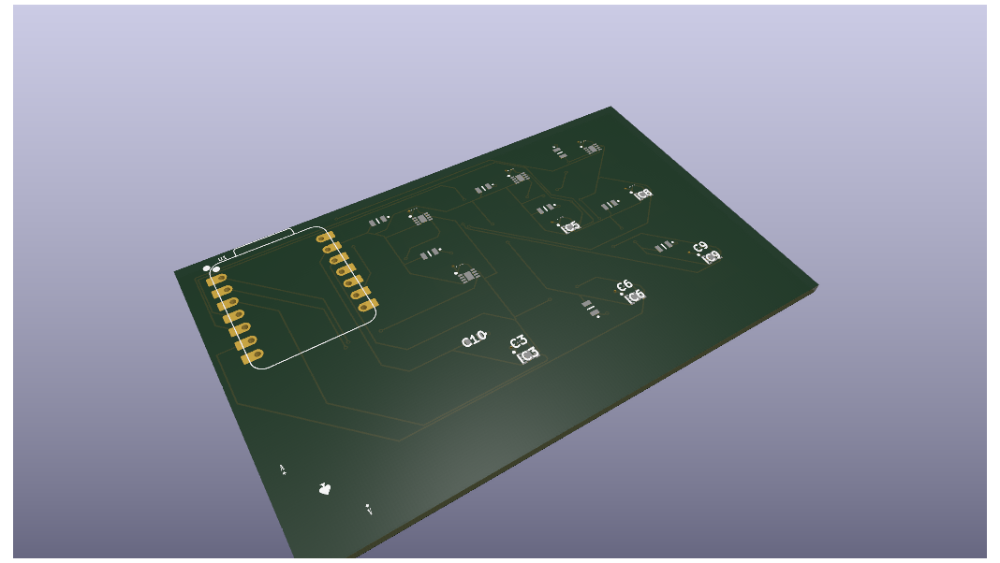
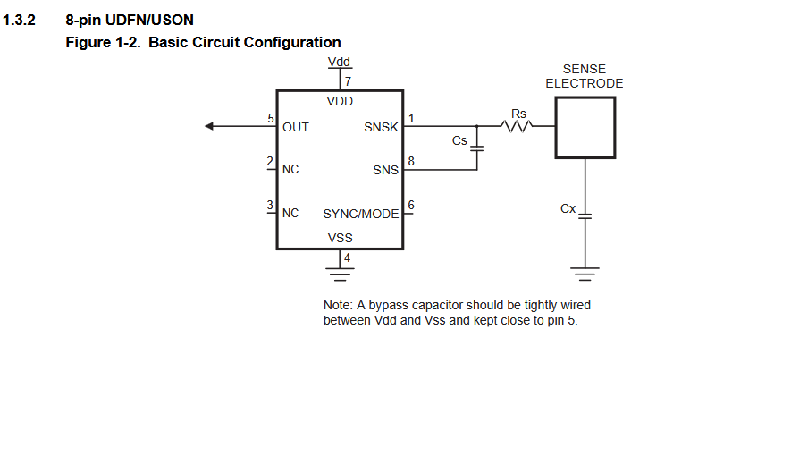
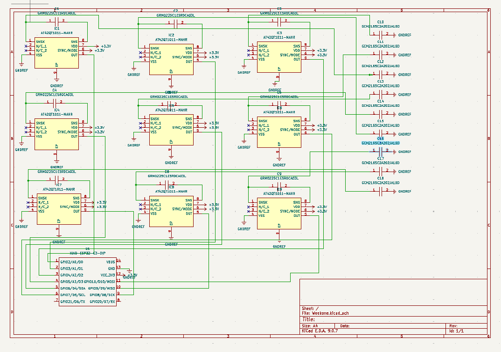
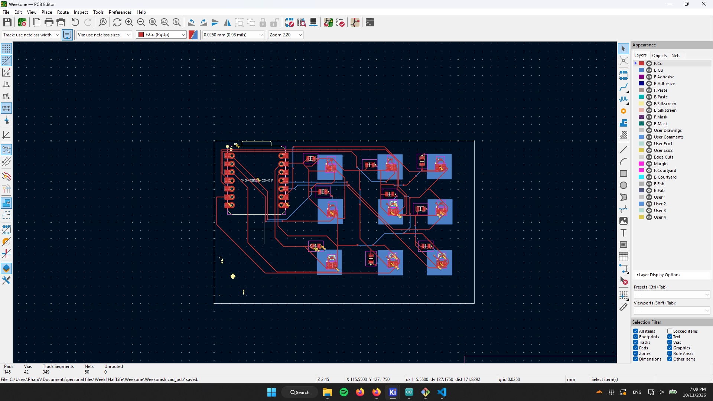
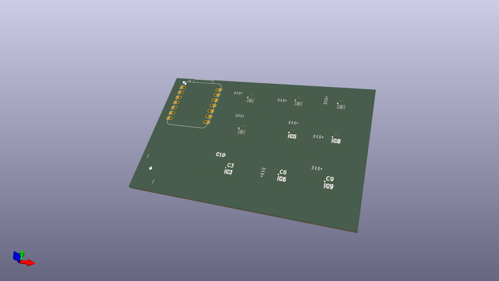
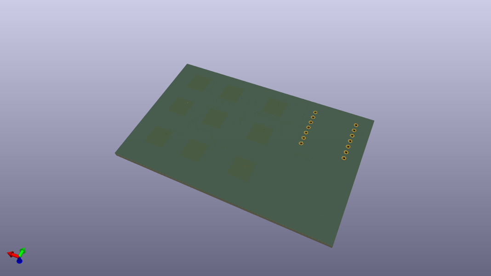

# The Steno Macropad
**Note: in the journal some hours are logged on one day despite being done on differnt days because I didn't realise how this worked and waited**

The Steno-style macro-pad is designed to allow multiple keystrokes simultaneously to create new outputs. With conductive sensors, it creates a thin, portable *wired* macro-pad that still serves the functions of a much larger version.

### Code functionality
The keyboard works by taking all inputs from each of the capacitive sensors and filling in their respective states into a larger bitmap to compare to a predefined table of char arrays to print out to the keyboard. I made it using char arrays of characters, because I have had difficulties otherwise, and it's pretty nice for coding to have a quick list of all your common phrases when autocorrect fails.

### Hardware Choices
The traditional Macro-pad uses mechanical switches with 2 pins but is incredibly bulky and is much more prone to breaking. I opted to work with some capacitive touch sensors, which only need a copper pad to sense, with a Xiao Esp32 C3 for more ram/flash over an Arduino Pro Micro. The added flash allows me to code in more functions for the Macro-pad than the established Pro Micro. The UDFN/USON package of my sensor chip makes it smaller lets me get away with a smaller and thin pcb.

### Schematic design
Following the provided circuit plan from the data sheet of the IC, I wired the ***Steno Macro-Pad***

### PCB placing
Originally I wanted to keep **ALL** signal traces on one side, but the size of the PCB and other traces made it so I had to use some buried vias near the back side’s copper sense pads. But who can forget adding some personal symbol in the silk screening, mine being an ace of spades. alt text The large blue squares being the copper pads on the back side.  The large blue squares being the copper pads on the back side.

## Render

